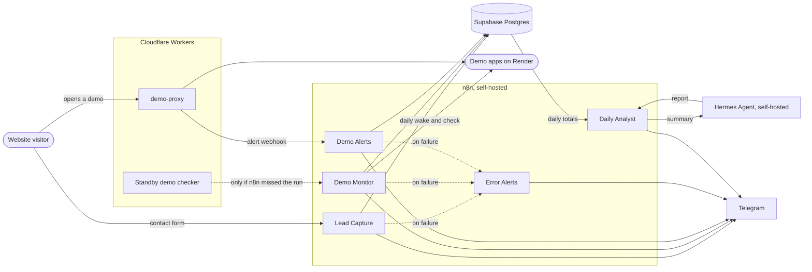

# n8n Workflows

Production automation workflows built with [n8n](https://n8n.io) and running on my own self-hosted instance. They capture leads, monitor live demo apps, and send alerts to Telegram, with every event stored in Postgres for history and reporting. Every morning a self-hosted AI agent ([Hermes](https://github.com/NousResearch/hermes-agent)) reads the day's numbers and writes a report with what needs attention and one idea to improve.

Each workflow is importable as JSON and has its own README with setup steps, credentials and example messages.

## Workflows

| Workflow | What it does | Trigger |
|---|---|---|
| [Lead Capture](workflows/lead-capture/) | Public contact form that validates each submission, saves it to a Supabase leads table, sends genuine leads to Telegram instantly, and collects spam into one silent daily digest so no real lead is lost. Website demo signups and quote requests arrive here too (copied by the signup Worker after Brevo), so every lead is in one table | n8n Form + webhook + daily schedule |
| [Demo Monitor](workflows/demo-monitor/) v1.3 | Checks every morning that each demo app on Render wakes up and opens (a Cloudflare Worker's check stands by in case n8n misses a run), keeps uptime history, flags slow pages, wake-up refusals and failure streaks, sends a daily report and a weekly summary, and alerts if the check never ran | Webhook + daily and weekly schedules |
| [Demo Alerts](workflows/demo-alerts/) v1.3 | Real-time Telegram alerts when a visitor wakes a sleeping demo, when it opens, and when it fails to start, sent by a Cloudflare Worker proxy in front of the demos | Webhook |
| [Social Publisher](workflows/social-publisher/) | Multi-client Facebook and Instagram publishing: onboarding and scheduling forms, a publisher that retries and alerts per platform, a daily preview and results refresh, and a weekly report per client with an AI-written analysis | n8n Forms + 15-minute, daily and weekly schedules |
| [Daily Analyst](workflows/daily-analyst/) | Collects the day's numbers from every system (posts and results, leads, demo uptime, workflow failures), sends the totals to a self-hosted Hermes Agent with memory, and posts its report to Telegram: what needs attention, week-over-week trends, one improvement idea and today's top action. Free models with automatic fallback | Daily schedule |
| [Error Alerts](workflows/error-alerts/) | Shared error workflow: any failing workflow sends a Telegram alert with the workflow, the failed step, the error and a link to the execution | n8n Error Trigger |

New workflows start from [`_template`](workflows/_template/).

## Architecture



- **Cloudflare Workers** sit in front of the demos (the demo-proxy sends visitor alerts) and stand by: n8n records each run, and if it misses one, the Worker does the job instead and emails about it. The daily demo check runs from n8n because Render refuses to wake a free service for requests from Cloudflare's shared addresses.
- **n8n** validates every payload, stores it, decides what is worth a notification, and formats the message.
- **Supabase Postgres** keeps the full history (leads, health checks, alerts) in separate schemas with row level security on.
- **Telegram** is the notification channel: loud for problems that need action, silent for reports and digests.
- **Hermes Agent** runs next to n8n with every tool except memory turned off. Its API is reachable only from n8n; it also has its own Telegram bot that answers only my account. n8n does the data work with fixed queries; the agent only reads the totals and writes the report.

## Tech used

| Area | Tools |
|---|---|
| Automation | n8n (Form, Webhook, Schedule and Error triggers, Code nodes in JavaScript, Postgres, Telegram) |
| Edge | Cloudflare Workers (TypeScript) |
| Database | Supabase Postgres, SQL views and indexes |
| AI agent | Hermes Agent (Nous Research), self-hosted in Docker; free models from Google AI Studio, Nous Portal and OpenRouter with automatic fallback |
| Notifications | Telegram Bot API |
| Hosting | Docker Compose on an Oracle Cloud Arm VM, Caddy for automatic HTTPS |

## How the workflows are built

- **Secure webhooks**: every webhook checks a shared secret header and validates the payload before anything is stored.
- **Fast replies**: webhooks answer `202` right away, then do the work, so the sender is never kept waiting.
- **Safe retries**: unique keys in Postgres mean a repeated delivery is ignored instead of duplicated.
- **Parameterized SQL**: no user input is ever pasted into a query.
- **Nothing fails silently**: a missed-run check catches a sender that stopped reporting, and Error Alerts covers every other failure.
- **No secrets in the repo**: workflows reference n8n credentials by name only.

## Use it for your business

The same patterns fit most small business automation needs:

- **Lead handling**: website or landing page forms straight into a database and your phone, with spam filtering and follow-up reminders.
- **Monitoring**: uptime, slow pages or failed jobs for your website, store or internal tools, with a daily report instead of manual checks.
- **Alerts and reports**: the right message to the right person on Telegram, Slack or email, plus daily and weekly summaries from your own data.
- **Connecting your tools**: forms, CRMs, spreadsheets, databases and APIs linked without copy and paste.

You can import any workflow here and adapt it yourself, or contact me to have it set up and customized for your business.

## Importing a workflow

1. Download `workflow.json` from the workflow's folder.
2. In n8n: **Workflows > Create workflow**, then the **⋯** menu > **Import from File**.
3. Run the workflow's `setup.sql` in Supabase, if it has one.
4. Create the credentials listed in that workflow's README and select them in the matching nodes.
5. Test the workflow, then publish it.

## Repository layout

```
workflows/
  <workflow-name>/
    workflow.json   importable n8n workflow
    README.md       what it does, setup, credentials needed
    setup.sql       database tables, if the workflow stores data
  _template/        starting point for new workflows
infra/              hosting config for the n8n instance
```

## Hosting

The instance runs n8n in Docker on an Oracle Cloud Always Free Arm VM, with Caddy for automatic HTTPS and a Supabase Postgres database for workflows and credentials. Config is in [`infra/`](infra/).

## Roadmap

Planned improvements. Done items are ticked, then moved into the sections above.

**Repository**

- [ ] One settings node per workflow (timezone, Telegram chat ID, thresholds) instead of values written into each node
- [ ] Screenshots of each workflow canvas and example Telegram messages
- [ ] Contact link to [nb-systems.naja.live](https://nb-systems.naja.live)

**Lead Capture**

- [ ] Auto-reply email to the visitor
- [ ] Duplicate check: look up the email before saving a new lead
- [ ] Genuine leads included in the morning digest as a daily summary

**Monitoring**

- [ ] External watchdog for the n8n server itself, so an outage that stops Error Alerts is still reported

## Author

Naja Boughader · [GitHub](https://github.com/Naja-crtl) · [LinkedIn](https://www.linkedin.com/in/naja-bou-ghader-1a2822249)
